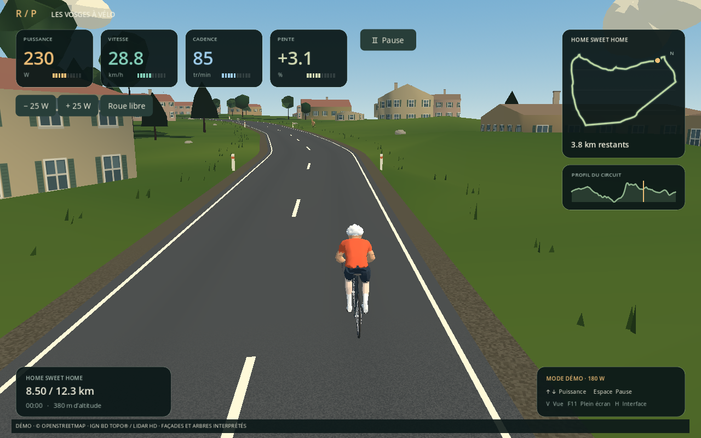
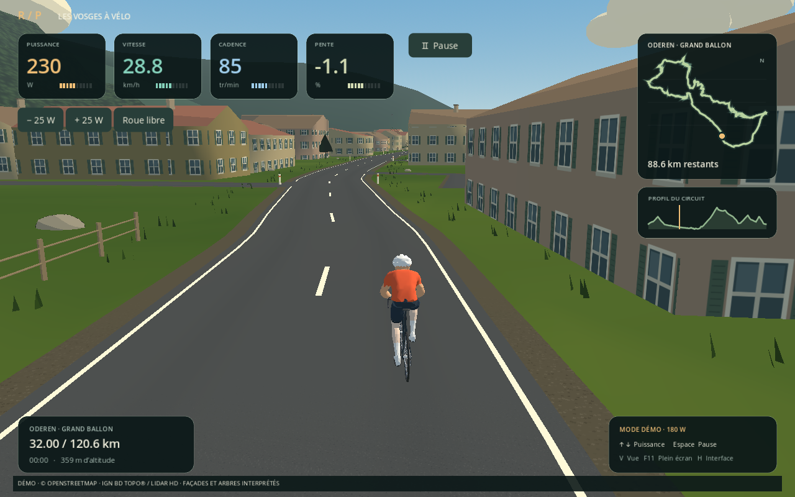

# Rois de la Pédale 0.7.1 — Lisières et visibilité

Les quatre circuits disposent de lisières reconstruites : petits groupes de couronnes irrégulières et troncs, placés dans les parcelles IGN en respectant les ouvertures. Le couvert proche rejoint le sol forestier et le volume lointain se relève progressivement, pour éviter les grands murs verts au bord de la route.

Les arbres sont préparés jusqu’à 480 m devant le cycliste ; leur visibilité diminue progressivement entre 235 et 330 m. Les racines suivent le terrain réellement affiché. Les fenêtres texturées restent présentes au-delà de l’ancienne limite de 160 m et s’atténuent entre 220 et 340 m, sans objet par fenêtre.

Les arbres de bord de route utilisent quatre silhouettes de moins de 100 triangles chacune, regroupées par secteurs et instanciées sur le GPU, sans ombres supplémentaires. Les couronnes des parcelles sont limitées à 28 groupes par secteur de 256 m à proximité du parcours. Le cache forestier reste limité à 192 secteurs. Ces choix visent notamment l’Intel UHD Graphics 600 ; les performances sur ce matériel restent à confirmer sur le PC utilisateur.

Le paysage reste une interprétation stylisée des données IGN, et non un inventaire individuel des arbres. Bluetooth, circuits et commandes de caméra sont conservés.

## Captures natives en mode Léger

## Mesures de rendu

Comparaison native en mode Léger, mêmes stations, moteur OpenGL logiciel llvmpipe du cloud : Oderen 105 865 → 103 519 triangles affichés, 324 → 341 appels de dessin ; Sortie matin 125 530 → 115 940 triangles, 293 → 316 appels. Temps médians respectifs 30,5 → 33,8 ms et 39,0 → 37,4 ms. Mesures indicatives : le coût varie selon la vue et ces chiffres ne prédisent pas les FPS de l’Intel UHD 600.

## Validation

52 tests Python et 307 vérifications natives réussis. L’exécutable Linux exporté a été lancé sur les quatre circuits avec les deux cyclistes (8 combinaisons), avec contrôle des activités, des données géographiques et des ambiances. Les 7 956 secteurs forestiers ont été décompressés et contrôlés : empreintes SHA-256, tailles, valeurs finies et limite des groupes de couronnes. Cinq captures natives ont été produites en mode Léger.

## Installateur publié et vérifié

[Télécharger l’installateur Windows v0.7.1](https://github.com/Ritterschaft69/RoisDeLaPedale_desk/releases/download/v0.7.1/RoisDeLaPedale-0.7.1-Setup.exe). Fichier téléchargé après publication, en-tête Windows MZ et SHA-256 vérifiés : 155392384 octets.

SHA-256 : `1a0cd89e3249efc0fe9c580d62f4438accb14236a41b939328140b33a067ed63`.

[Fabrication GitHub réussie](https://github.com/Ritterschaft69/RoisDeLaPedale_desk/actions/runs/41606857434), source `9008d50984cf1bfa40df500c7699f8e12f1d533c`. Les exécutables restent dans les assets de la release.
