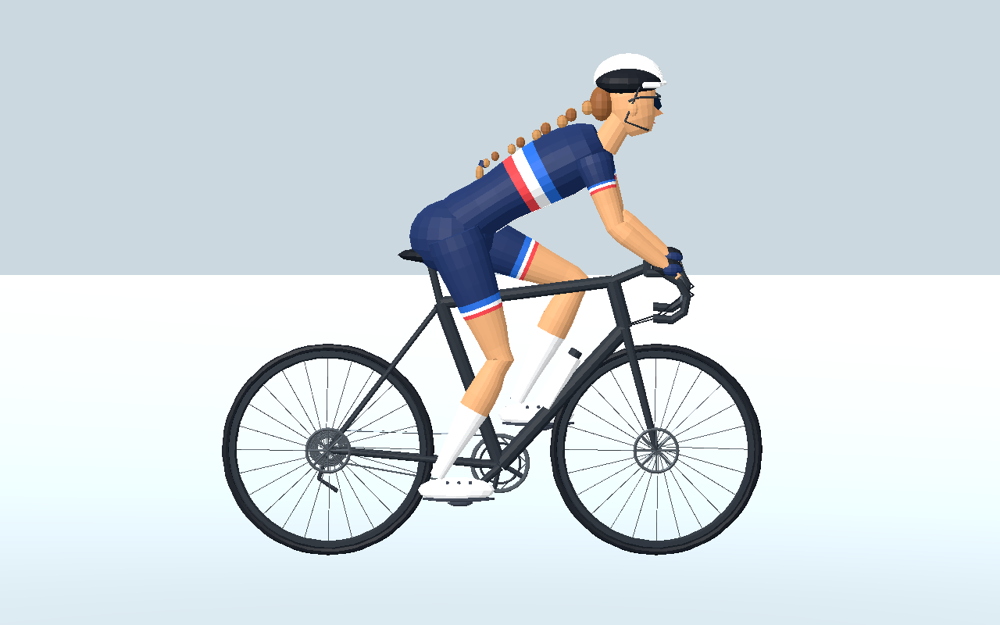
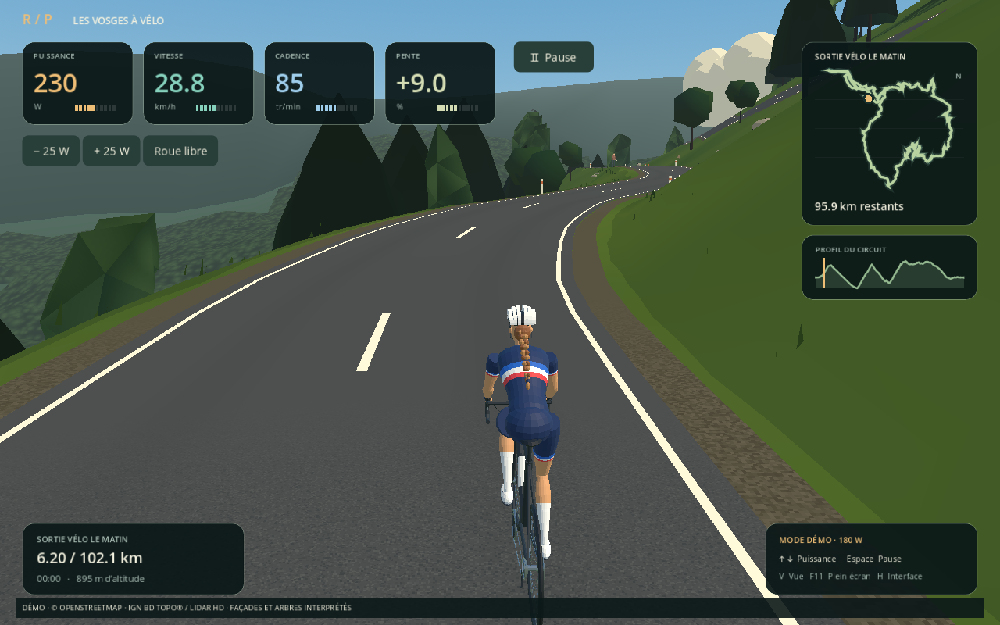

# Rois de la Pédale 0.7.2 — Cycliste tricolore fournie

L’option **Accueil → Cycliste → Tricolore** remplace l’ancien personnage par le fichier `cycliste_lowpoly_roadbike_rigged (1).glb` fourni par l’utilisateur. Le GLB est conservé sans modification, avec son vélo, ses proportions, ses matériaux, son squelette à 18 os et son animation `Pedal_60_RPM`. Le choix reste mémorisé.

Le pédalage suit la cadence, vers l’avant. Les roues suivent indépendamment la vitesse, avec leur rayon de 0,34 m. En roue libre, les jambes s’arrêtent et les roues continuent de tourner. Le modèle orange, les trois vues, les paysages et la connexion Bluetooth restent disponibles.

Le modèle complet contient 23 456 triangles. La licence de cet asset fourni n’a pas été précisée ; elle ne se confond pas avec les licences CC0 des ambiances ou celles des données géographiques.

